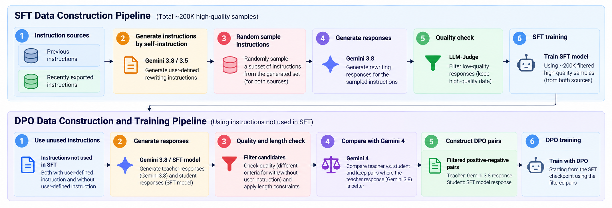

# Voice-Agent Retrieval Query Rewriter

Data construction, supervised fine-tuning (SFT), direct preference optimization (DPO), quantization, and evaluation for a voice-agent retrieval query rewriter built on Qwen3-4B-Instruct-2507.

The model turns a conversation into a concise search query for knowledge needed by the agent's next response. It supports user-defined rewriting instructions while preserving relevant names, entities, and constraints.



## Workflow

The maintained shell entry points are documented in [scripts/README.md](scripts/README.md). Edit their variables and comment/uncomment individual command blocks. There are nine top-level shells:

```bash
# Reuse the retained test/seed files or rebuild them.
bash scripts/construct_test_data.sh
bash scripts/construct_seed_data.sh

# Self-instructions, teacher rewrites, judging, selection, and SFT.
bash scripts/construct_sft_data.sh
bash scripts/train_sft.sh

# Ordinary DPO, then DPO from teacher-corrected student answers.
bash scripts/construct_dpo_data.sh
bash scripts/train_dpo.sh # Ordinary DPO block.
bash scripts/construct_dpo_data_contrast.sh
# Switch train_dpo.sh to its corrected-positive block before running it again.
bash scripts/train_dpo.sh

# Evaluate trained adapters and merged GPTQ weights separately.
bash scripts/test_query_rewriter.sh
bash scripts/test_quantization.sh
```

Commands are placed in order with numbered comments; select what to run by commenting/uncommenting the blocks. Training defaults use the retained datasets directly under `data/`. The model sequence is `Qwen3-4B-Instruct-2507-SFT` → `Qwen3-4B-Instruct-2507-DPO` → `Qwen3-4B-Instruct-2507-DPO-contrast`, saved under `ckpts/<name>/final/`. Quantization is a separate step under [quantization/](quantization/).

## Data and code

Two sources supply the data: previous annotated conversations and cleaned exported conversations. Authentic customer instructions provide self-instruction seeds. The SFT pipeline generates instruction variants and paired rewrites, judges their quality and instruction following, excludes test overlap, and prepares examples fitting 4096 tokens.

One selected conversation with one instruction variant yields two SFT examples: one with the additional instruction and one without it. The default reconstruction targets 50K selected conversations from each source, or 200K SFT examples before length filtering. Counts depend on available qualifying data.

Ordinary DPO compares teacher answers against SFT-student answers and retains teacher wins. Corrected-positive DPO selects student answers with poor instruction following or compactness and asks a teacher to correct them. Each DPO pair contains one shared prompt, one chosen answer, and one rejected answer. Both full branches must fit 4096 tokens.

| Path | Contents |
|---|---|
| [data/README.md](data/README.md) | Retained source, training, test, and seed datasets |
| [scripts/README.md](scripts/README.md) | Nine maintained shell entry points and run settings |
| [scripts/src/](scripts/src/) | Python construction, preparation, training, and evaluation code |
| [scripts/trash-bin02/](scripts/trash-bin02/) | Archived shell experiments and their original settings |
| [quantization/](quantization/) | Separate calibration sampling and W4A16 GPTQ quantization |
| [case_study/](case_study/) | Case-study tools and curated retrieval issue cases |

Many data files contain JSON Lines even with a `.json` suffix. Read one object per nonempty line. Large datasets, model weights, environments, credentials, generated outputs, and archived scripts are excluded from version control through [.gitignore](.gitignore).

## Evaluation

Both evaluation shells use the same prompt template and generate both instruction conditions. The default judge is `gpt-6-astra`.

| Metric | Generation and judging condition |
|---|---|
| Without-instruction quality | Generate and judge without the additional instruction |
| With-instruction IF | Generate and judge with the additional instruction |
| Retrieval-needed IF | With-instruction IF restricted to retrieval-needed test cases |
| Average output length | Response tokens for each condition, using a common tokenizer |

Scores use a 0–5 scale. Reports and generated/evaluated records are saved under `outputs/`; quantized-model evaluation uses `outputs/quantization/`. These scores assess the rewritten queries rather than downstream retrieval recall.
